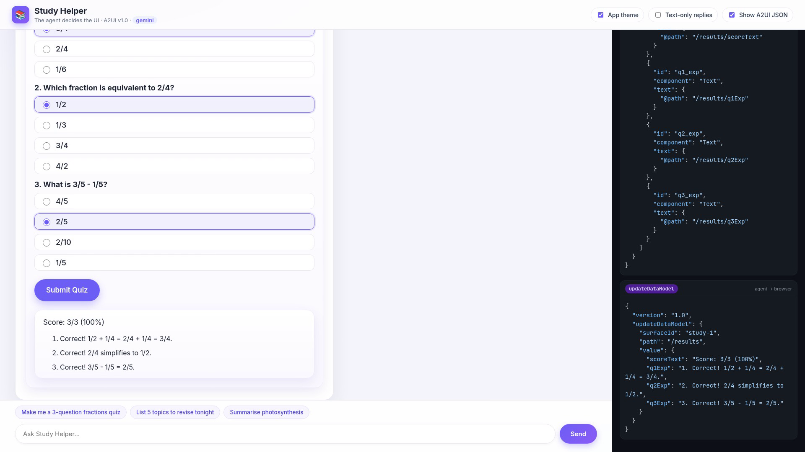
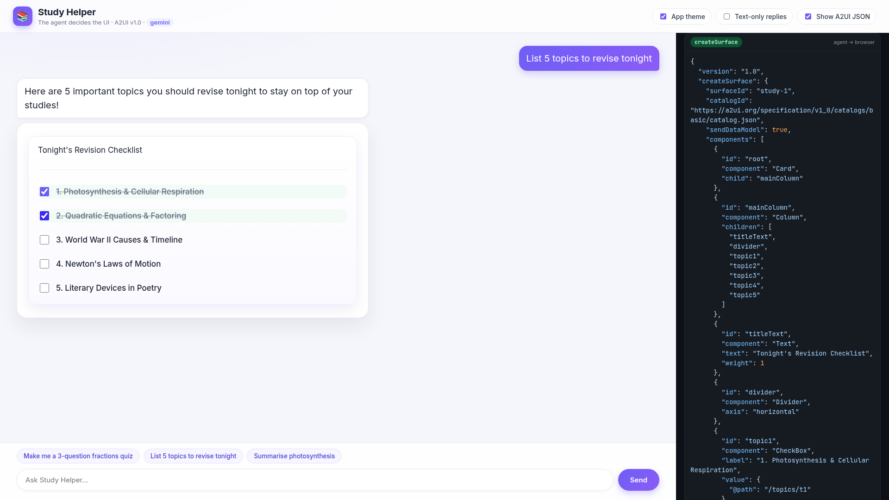
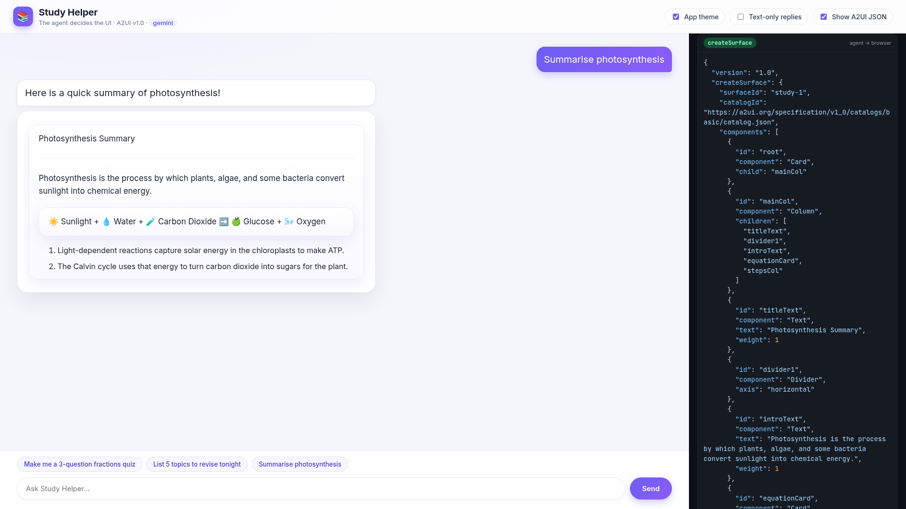
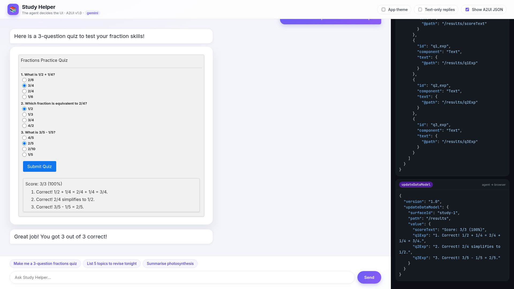

# Study Helper: an A2UI demo where the agent decides the UI

Ask a normal question. Instead of a wall of text, the agent answers with a
**real interface** that it picked for that question:

| You ask | The agent answers with |
| --- | --- |
| "Make me a 3-question fractions quiz" | a quiz you can tap. Press the submit button and the agent marks it. |
| "List 5 topics to revise tonight" | a checklist you can tick |
| "Summarise photosynthesis" | a summary card |

It is built on **[A2UI](https://a2ui.org) v1.0**, the open protocol (Apache 2.0)
that lets an agent describe a UI as JSON, so the app can draw it with its own
components. It uses the official packages:

- **`a2ui-agent-sdk`** (Python): the catalog, the prompt for the model, and the
  validator that checks every message before it leaves the server.
- **`@a2ui/web_core`** + **`@a2ui/react`** (browser): read the messages and draw them.

A panel on the right shows every A2UI message as it travels, so you can see
exactly what the agent sent.



| Checklist | Summary card |
| --- | --- |
|  |  |

---

## Run it (step by step)

### 1. Install the two tools it needs

- **Python 3.11 or newer**: check with `python3 --version`. Get it from [python.org](https://www.python.org/downloads/).
- **Node.js 20 or newer**: check with `node --version`. Get it from [nodejs.org](https://nodejs.org/).

On Windows, run the commands below in **WSL** or **Git Bash** (`run.sh` is a bash script).

### 2. Get the code

```bash
git clone https://github.com/davolu/a2ui-study-helper
cd a2ui-study-helper
```

### 3. (Optional) Add a Gemini key

With a key, a real Gemini model decides the UI. Without one, the app still works
with an offline scripted agent.

1. Get a free key at [aistudio.google.com/apikey](https://aistudio.google.com/apikey).
2. Copy the example settings file and put your key in it:

   ```bash
   cp .env.example .env
   ```

   Open `.env`, remove the `# ` in front of `GEMINI_API_KEY=` and paste your key after the `=`.
   `.env` is in `.gitignore`, so it never gets committed. Never share it or paste it in public.

   (Or skip the file and run `export GEMINI_API_KEY=your-gemini-api-key` in the terminal.)

### 4. Start it

```bash
./run.sh
```

The first run installs the Python packages (into `.venv`) and the web packages,
builds the web app, and starts the server. Then open **http://127.0.0.1:8000**.

The badge at the top says `gemini` when a key is set, or `scripted (offline)` without one.

### 5. Try it

Click one of the example buttons, or type your own request. Turn on
**Show A2UI JSON** to watch the messages arrive.

### Troubleshooting

- **The reply takes a while, or says the quota is exceeded.** Free Gemini keys have
  rate and daily limits. Study Helper retries and falls back to other Gemini models
  when one is busy, but if all of them are out of quota, wait for the limit to reset
  (or run without a key to use the scripted agent).
- **`./run.sh: Permission denied`.** Run `chmod +x run.sh` once.
- **Port 8000 is busy.** Start on another port: `PORT=8010 ./run.sh`.

### Offline scripted agent

Without a key, the answers are hand-written in `agent/scripted_agent.py`. It knows
the three example requests. They are still real A2UI v1.0 messages, and they go
through the same official parser and validator as a Gemini answer.

---

## The idea in 30 seconds

1. **The catalog** is the box of building blocks the app knows how to draw:
   `Text`, `Column`, `Card`, `List`, `Button`, `CheckBox`, `ChoicePicker`, and so on.
   We use A2UI v1.0's **basic catalog**. The agent can only use these blocks.
2. **The agent** reads your question and chooses which blocks to use.
3. It sends three kinds of message:
   - `createSurface`: "make a new piece of screen"
   - `updateComponents`: "here are the blocks, and how they fit together"
   - `updateDataModel`: "here is the data to show"
4. **The app** draws them with its own components, so it looks like the rest of the app.
5. When you press a button, the app sends an **`action`** message back, for example
   `grade_quiz` with the answers you picked. The agent replies with more messages
   that update the same surface.

---

## What is in this repo

```
agent/
  study_agent.py     the agent: catalog, Gemini call, SDK validation
  scripted_agent.py  the offline answers (real A2UI JSON you can read)
  server.py          a tiny web server: POST /api/chat
  check_invalid_ui.py  shows the SDK rejecting a block that is not in the catalog
web/src/
  a2ui.ts            the A2UI bits in the browser (MessageProcessor + basic catalog)
  App.tsx            the chat, the surfaces, and the toggles
  JsonPanel.tsx      the "A2UI messages" panel
  theme.css          the app's look for A2UI components (CSS variables)
  styles.css         the look of the chat around them
run.sh               installs everything and starts the app
.env.example         the settings you can set (copy to .env)
```

### Agent side (Python)

```python
CATALOG = BasicCatalog(ProtocolVersion.V1_0)              # the building blocks
GENERATOR = A2uiGenerator([CatalogConfig(CATALOG)],
                          inference_format_factory=DirectJsonFormatFactory())

processor = GENERATOR.create_processor(browser_capabilities)   # per browser
system_prompt = ROLE + processor.prompt_snippet                 # teaches the model A2UI
parts = processor.parse_response(model_reply, state=state)      # validates every message
```

If the model writes something that is not in the catalog (say a `Spaceship`
component), `parse_response` raises an error and nothing broken reaches the
browser. With Gemini, Study Helper asks the model once more, quoting the error.

### Browser side (React)

```ts
const processor = new MessageProcessor([basicCatalog], action => sendToAgent(action));
processor.processMessages(messagesFromAgent);
<A2uiSurface surface={processor.getSurface('study-1')} />
```

### Your app owns the look

The agent only says *which* components to show. How they look is up to the app.
The basic catalog components read `--a2ui-*` CSS variables from `@a2ui/web_core`,
and its default theme uses `:where()`, so the app's values simply win.
See [`web/src/theme.css`](web/src/theme.css). Here is the same quiz with A2UI's
plain default theme (the **App theme** switch turned off):



A few of the variables:

```css
.theme-study {
  --a2ui-color-primary: #6d5ef5;
  --a2ui-card-border-radius: 18px;
  --a2ui-card-box-shadow: 0 10px 28px rgba(76, 64, 180, 0.10);
  --a2ui-button-border-radius: 999px;
}
```

---

## Toggles

- **App theme** switches between the Study Helper theme and A2UI's plain default
  theme (also `?theme=plain` in the URL). Same JSON, different look.
- **Show A2UI JSON** opens or closes the message panel.
- **Text-only replies** asks for the same answer as plain chat text, so you can
  compare a text reply with a UI reply.

## Notes

- This is a teaching demo, not a production app. Sessions live in memory.
- The scripted answers are fixed examples. The topic list, for instance, is a
  sample school revision list rather than something based on your own work.
- Developing the UI: run the agent with `cd agent && ../.venv/bin/uvicorn server:app --port 8000`,
  then `cd web && npm run dev`.

## Learn more

- A2UI v1.0 specification: https://a2ui.org/specification/v1.0-a2ui/
- Google's official samples: https://github.com/a2ui-project/labs

## Licence

Apache 2.0. See [LICENSE](LICENSE).
